# Chapter 7.6 深入与进阶

| 部分 | 对应正文 | 讲什么 |
|---|---|---|
| 第一部分 FunctionChain 重排阶段 | 7.3.2 | L0/L1/L2 在哪执行、候选怎么一层层合并、分数方向 |
| 第二部分 稀疏倒排索引的遍历算法 | 7.4.1 | DAAT/TAAT、MAXSCORE/WAND、Block-Max、SINDI、Knowhere |
| 第三部分 存储与写入引擎 | 7.1.2 / 7.2 / 7.4 | Vortex/Lance、Woodpecker、强制合并、Storage V3 清单、外部集合刷新与快照成本 |
| 第四部分 StructArray | 7.4.3 | 同元素过滤、两种检索粒度、EmbeddingList 候选策略、Hybrid 折叠 |
| 第五部分 Regex 过滤 | 7.2 / 7.3 的检索过滤 | RE2、NGRAM 候选生成、NULL 三值逻辑、性能边界 |
| 第六部分 聚合与 ORDER BY | 7.5.2 可选步骤 | Query 精确汇总、Search 候选桶、Grouping 区别、两条排序路径 |

## 第一部分 · FunctionChain 重排阶段（L0 / L1 / L2）

> 重点一句话：三道重排各自在哪一层执行、能看到多大范围的候选。这一点确定了，如何选型自然就知道了。

### 一、数据是怎么分布的

collection 按 `shard_num` 切成多个 shard，每个 shard 再分成多段 segment；每个 shard 有一个 delegator（分片负责人，本身也是一台 QueryNode），把 segment 分给几台 worker 保管和检索。每台 worker 只碰分到自己名下的那几段 segment。

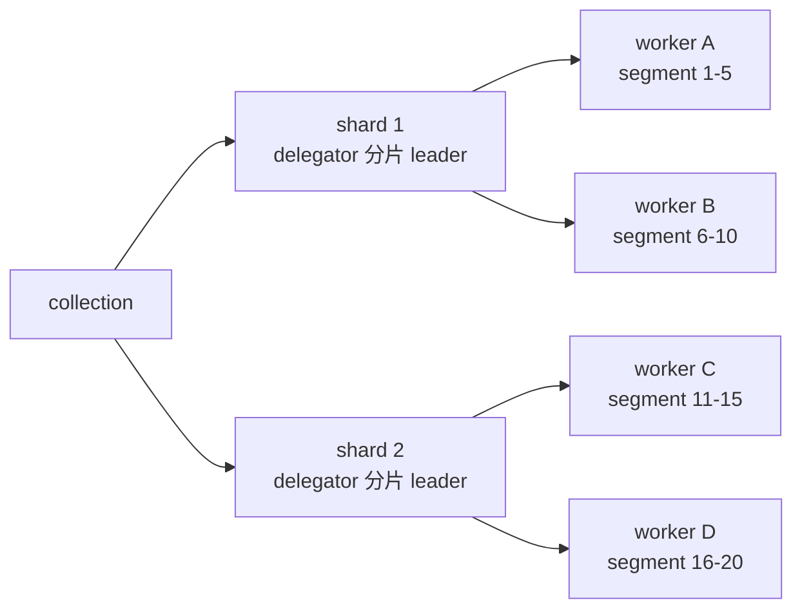

### 二、三道重排在哪执行、看到多少

搜索结果的后处理挂在 `L0_RERANK` / `L1_RERANK` / `L2_RERANK` 之一。按「结果在哪一层被合并」划分，三道的位置和视野是：

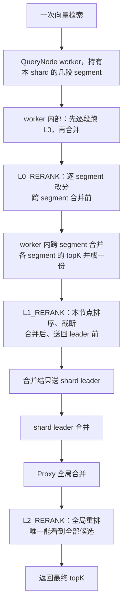

| 阶段 | 在哪执行 | 在合并流程的哪一步 | 能看到的数据 | 支持的操作 |
| --- | --- | --- | --- | --- |
| `L0_RERANK` | QueryNode | 跨 segment 合并**前**（逐 segment） | 单个 segment 的结果 | `map` |
| `L1_RERANK` | QueryNode | 本节点 segment 合并**后**、送回分片 leader **前** | 本节点合并后的候选 | `map` / `sort` / `limit` |
| `L2_RERANK` | Proxy | 全局合并**后** | 全部分片汇总后的全部候选 | 通用（`map`/`sort`/`limit`/`filter` 等，含模型重排） |

### 三、候选数怎么一层层变少

向量检索在每段 segment 上只返回 topK 条，之后每一层都在重复同一件事：把下面交上来的多份 topK 按分数合并成一份。以 100 万行、3 个 shard、topK=100、每 shard 10 段 segment、每 shard 2 个 worker 为例：

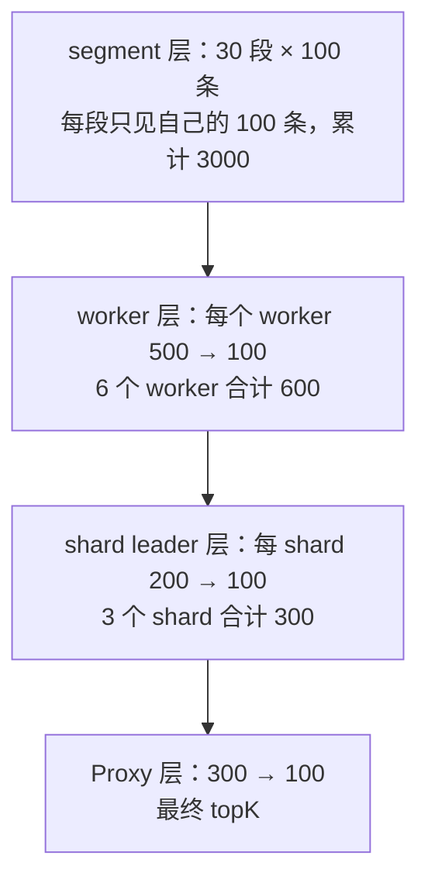

三道重排就是上图里的三个插入口：`L0` 在合并前逐 segment 执行，只能看到单个 segment 那 100 条；`L1` 在 worker 合并后、送回 leader 前执行，能看到这个 worker 合并出的 100 条；`L2` 在 Proxy 全局合并后执行，能看到最终那 100 条。

不用函数链时，QueryNode 会不会返回和原始查询不一样的数据？不会——三道重排处理的都是这次查询本来会返回的那批 topK，差别只在截取位置。真正扫全库的距离计算只发生在 ANN 检索里。

### 四、提前处理省什么、省不掉什么

提前处理省不了检索本身，省的只有往上层的路要传多少行、拿到行后要算多少。

**省不掉的是：每段 segment 的检索。** L0 只能改分，不能让某段少检索。

**省的第一件事：少传行。** 6 个 worker 各回 100 行，Proxy 收到的就是 600 行，再自己排序、截断、跑模型重排。给 L1 加 `limit: 50` 的话：每个 worker 先在本地排好、只留 50 行，Proxy 就只收 300 行，后面的排序和重排都少干一半活。注意 `limit` 是**每个 worker 各留 50 行**（不是总共 50 行）；留太少，该上榜的行在源头就被扔掉了，后面找不回来。

**省的第二件事：先改分，再选行。** L0 在合并之前就把每段的分数改好（比如把「距离越小越好」翻成「分数越大越好」，或按业务规则逐行调分）。这样 worker、leader、Proxy 每一层选 topK 用的都是新分数。如果拖到 L2 才改：前面几层早就按原始分数选完了——被原始分数淘汰的行根本到不了 L2，改分也改不到它们。

### 五、什么时候用 L0 / L1 / L2

| 需求 | 用哪个 | 注意 |
|---|---|---|
| 逐行改分，让后面的合并按新分数选 topK（距离转相似度、逐行调分） | `L0` | 只有 `map`，看不到别的 segment |
| 量大、追低延迟，想先在本节点排好序、筛掉一批再上传 | `L1`（`map`/`sort`/`limit`） | 典型搭配是「`L1` 先压一轮候选 + `L2` 最终全局重排」；`limit` 是每个 worker 各自的限额，别把召回减没 |
| 要全局唯一排序、要跑外部模型 rerank、要把所有分片汇总后统一比总分 | `L2` | 代价是中心点要对全部候选排序，没有提前筛掉一批的机会 |

hybrid search 多路子查询：每个子查询是独立的一次 ANN，可以各自挂 `L0`/`L1`；但几个子查询的结果怎么合成一个榜单，只能在顶层 `L2` 做——顶层 `L2` 链的第一环必须是 `merge`，各子查询之间也不共享中间列。

### 六、分数方向：为什么正文建索引用 COSINE 不用 L2

7.3.2 埋了一句「为什么不选 L2，坑里会说」，这里补上。三条常用度量的方向：

| 度量 | 方向 | 常见场景 |
|---|---|---|
| `COSINE`（余弦相似度） | 分数越大越相似，范围约 [-1, 1] | 文本 embedding 最常用 |
| `IP`（内积） | 分数越大越相似 | 稀疏向量 / BM25 全文检索（SINDI 就是 IP 度量的默认算法） |
| `L2`（欧氏距离） | 数值越小越相似，它是距离，当不了分数 | 图像特征、未归一化向量 |

正文函数链示例统一用 COSINE，因为后面的排序、重排、多路融合都默认「分数越大越好」；混进 L2，排序方向就反了。官方没有强制这一点（L2 也能查），属于组合分数的实践约定：**要么全用「越大越好」的度量，要么在链里先做方向转换。**

### 附：换模型没提前建向量列怎么办

7.3.3 假设第二列 `vec_v2` 建表时就一起建好了；这里回答另一件事——线上集合跑了很久、当初没预留新列，现在要换模型怎么办。

**官方：事后补列三步**：`add_collection_field` 加列 → 先 `create_index` → `upsert(partial_update=True)` 按 id 分批回填。

**索引卡在 `InProgress` 怎么解除**（3.0.2 实测出现过「零行被索引、永不推进」，按顺序试）：

1. `drop_index` 删掉卡住的索引，重新 `create_index`；
2. 不行 `drop_collection_field` 删列重来；
3. 还不行重启 datacoord / indexnode 容器；
4. 都无效再升级 Milvus 或到 GitHub 提 issue。

**生产兜底：新集合 + 双写切换**——新建带 `vec_v2` 的集合，新数据双写，老数据按 id 分批导出重插（或 `milvus-backup`），验证后应用切读新集合。代价是迁移期双写，但最稳。

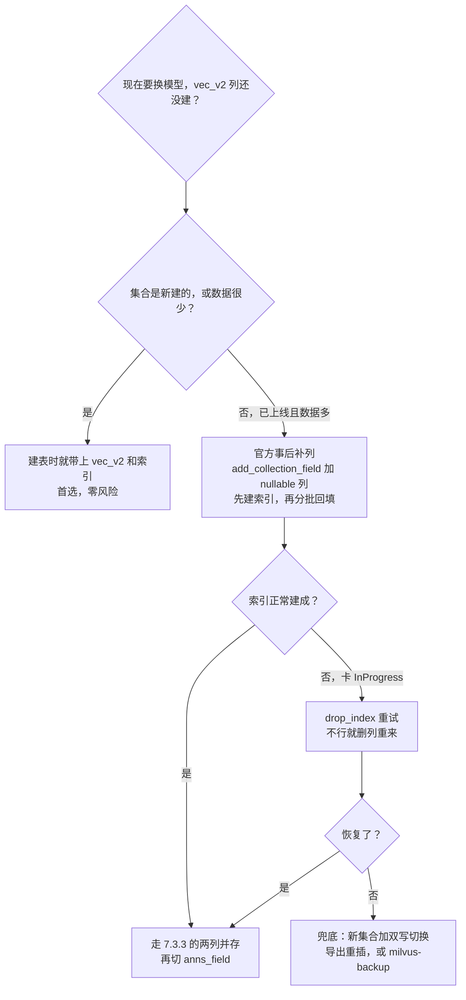

---

## 第二部分 · 稀疏倒排索引的遍历算法

> 重点一句话：`inverted_index_algo` 的几个取值干的是同一件事——从倒排链里找出总分最高的 k 篇文档，差别只在遍历顺序和怎么跳过大量文档。3.0 新增了 SINDI 和两个 Block-Max 取值；不指定时，BM25 默认 DAAT_MAXSCORE，IP 默认 SINDI。

对应正文：[7.4.1 稀疏索引换代](./7.4-Milvus3.0索引与性能选择)。

### 一、先建立一个模型

倒排索引里，每个查询词挂着一条「含有这个词的文档 ID」列表，叫倒排链。一次查询就是从几条链里找出总分最高的 k 篇文档：

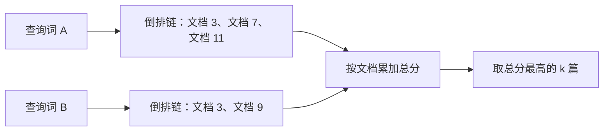

### 二、两个遍历方向：DAAT 与 TAAT

| 对比 | DAAT（按文档过） | TAAT（按词过） |
|---|---|---|
| 步进单位 | 一篇文档：把它在各查询词上的得分加总，就是这篇文档的总分 | 一个词：整条倒排链走完，给碰到的文档累加分数，再换下一个词 |
| 中间状态 | 维护当前前 k 名名单 | 一张「文档 → 累加分数」表 |
| 排名时机 | 边过边排，差的文档随时可以放弃 | 全部词走完后统一排名 |
| 剪枝空间 | 大，上界剪枝都建在这类遍历上 | 小 |

`TAAT_NAIVE` 就是 TAAT 的朴素实现，不剪枝，适合当对照基线，或打分依赖全库统计量的场景。

### 三、DAAT 的剪枝：MAXSCORE 与 WAND

DAAT 提前给每个查询词记一个「分数上限」——这个词最多能给一篇文档加多少分，够不着前 k 名就跳：

| 算法 | 什么时候跳 | 跳过什么 |
|---|---|---|
| `DAAT_MAXSCORE` | 「已得分 + 还没算的词的上限」都进不了前 k 名 | 这篇文档剩下的词，直接看下一篇 |
| `DAAT_WAND` | 所有词的上限全加上，还够不到当前第 k 名 | 整篇文档，连打分都省 |

取舍：MAXSCORE 丢一篇文档后半段的打分，WAND 直接丢整篇。所以查询词多、k 大时 MAXSCORE 稳，查询短、k 小时 WAND 省得多——官方参数页就按这个分场景。

### 四、Block-Max 与 SINDI

**Block-Max：给每条倒排链的每一小段记一个「最高分」，够不到就整段跳过。**

查询时你随时知道「当前第 k 名是多少分」，这个分数就是及格线——低于它的文档进不了榜。Block-Max 把每条倒排链按固定大小切成小块（比如每 128 篇一块），建索引时就记好每块里最高的那个分数。查询拿到一块，先看它的最高分：

- 整块最高分都低于及格线 → 这一块不可能有文档进榜，整块跳过，一篇都不比；
- 最高分过线 → 进块里逐个比。

举例：及格线 0.8，某块最高分 0.6，这 128 次比较全省了；另一块最高分 0.9，进去比，可能只有一两篇真正过线。块越小，跳得越细，但每块的记录也越多——`BLOCK_MAX_MAXSCORE` / `BLOCK_MAX_WAND` 就是在 MAXSCORE / WAND 上加了这层。

**SINDI：把文档分组，一次比一组。**

普通做法是一篇一篇文档比分数，CPU 一次只算一个。SINDI 把倒排链上的文档按固定大小分组、整齐排放，查询时用 CPU 的 SIMD 指令——一条指令同时对一组数据做比较和累加——等于一次算一组。它是稀疏向量内积（IP 度量）的默认算法。

官方内部基准给过两个数：压缩后的 BM25 索引比 2.6 的稀疏索引小约 3 倍；学习型稀疏 Embedding 上 QPS 最高到 MaxScore 的 10 倍。换自己的数据要实测。

### 五、取值对照表

`inverted_index_algo` 在构建索引和执行查询时都生效：

| 取值 | 遍历方向 | 剪枝 | 典型场景 |
|---|---|---|---|
| `DAAT_MAXSCORE` | DAAT | 逐文档丢「后半段打分」 | BM25 默认；查询词多、k 大 |
| `DAAT_WAND` | DAAT | 整篇文档跳过 | 查询短、k 小 |
| `TAAT_NAIVE` | TAAT | 无剪枝 | 对照基线；打分依赖全库统计量 |
| `BLOCK_MAX_MAXSCORE` | DAAT | MAXSCORE + 整块跳 | MaxScore 路子上再压延迟 |
| `BLOCK_MAX_WAND` | DAAT | WAND + 整块跳 | WAND 路子上再压延迟 |
| `SINDI` | 固定文档 ID 窗口 + SIMD | 窗口并行比对 | IP 度量默认；稀疏向量检索 |

### 六、Knowhere：工厂字符串最终交给谁

7.4.2 的 FAISS 直通把工厂字符串转交给底层索引引擎 Knowhere；SINDI、FAISS 直通、各类量化的构建、加载、查询都在它里面完成。7.4.2 提到「COSINE 度量下索引重新加载后分数要重新验证」，根源就在它：反序列化时没恢复 cosine 归一化状态。


### 参考文档

- [Sparse Inverted Index](https://milvus.io/docs/zh/sparse-inverted-index.md)（`inverted_index_algo` 参数表与默认值）
- [Milvus 发布说明](https://milvus.io/docs/zh/release_notes.md)

---

## 第三部分 · 存储与写入引擎

> 这一部分讲底层换掉的几样东西：数据在磁盘上用什么格式存（Vortex、Lance 两种新格式）、写数据走哪个引擎（Woodpecker，不用再外挂 Pulsar 或 Kafka）、零散的小段怎么合并成大段（强制合并）。再讲一个共用机制：Milvus 3.0 把所有数据记成一份「清单」，清单写进去就不再改，要变就整份重写一份新的。外部集合、快照、milvus-table 都靠这个机制工作。

### 一、存储格式：Vortex 与 Lance

先补个背景：Milvus 存数据靠列式文件，这类文件是为「一次扫一大块」设计的。但 AI 数据的用法在变——查询常常只按 ID 取几行，数据还越来越多地直接放在数据湖里，不想搬进 Milvus。3.0 因此动了存储层：内部格式换成 Vortex，外部对接用 Lance，读引擎叫 Loon。两个格式各管一头：

| 格式 | 管什么 | 谁在用 |
|---|---|---|
| Vortex | Milvus 内部存储的新格式，官方口径「将成为默认的内部格式」，TEXT 字段的大文本文件就用它 | Milvus 自己，自动接管 |
| Lance | 开放格式，和 Parquet 并列，湖上的表常用它 | 外部 Collection 直接引用湖上的 Lance 表（7.2.1） |

你不用手动选：写进 Milvus 的数据，它自己按 Vortex 存；只有数据已经在湖上、想不搬数据直接用外部集合读时，才碰 Lance。

#### Loon：解决「只要几行，却读进一大块」

向量检索分两步：先找出最相近的 100 个候选 ID；再拿着这 100 个 ID 回表，把每条的标题、价格取出来。亏就亏在第二步：文件按大块存放，取 100 行的几列也得把整块读进来，读完再挑，大部分内容直接扔掉。读的比用的多得多，这就是读放大。

Loon 是 3.0 的读引擎：把各列按行号对齐、切成小组存放，取哪几行就读哪几行所在的小组。它不挑文件格式——Parquet、Lance、Iceberg、Vortex 都走这一套读法。

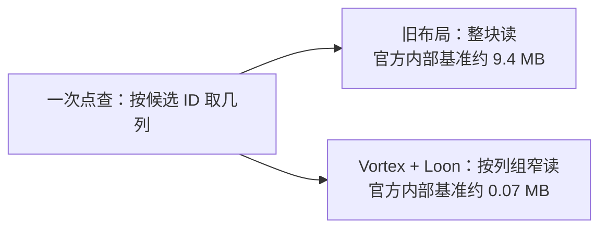

官方在 300 万行、S3 的环境里测到约 135 倍 I/O 缩减。加列删列也变轻了：先只改元数据，新列的值后台慢慢回填，旧列组不动。

### 二、写入引擎：Woodpecker

背景：写入为什么要先记日志？为了不丢。数据进来先按顺序追加到一份日志里，后台再慢慢整理入库；就算进程中途挂了，日志还在，恢复时照着重放就行。2.x 里这份日志由消息队列 Pulsar 承担，3.x 换成了内置的 Woodpecker：

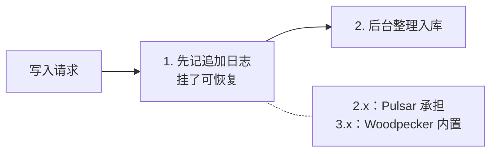

要点三条：单机版你感觉不到 Pulsar，因为它嵌在 Milvus 进程里跑；集群版以前要在部署清单里额外起一个 Pulsar 服务，3.x 省了这一步；大集群还可以把 Woodpecker 单独拆成一个服务，方便扩容。

### 三、强制合并：把零散小段并成大段

背景：数据写进 Milvus 会切成一个个「段」，段是后台整理的基本单位——合并、建索引都按段来。系统平时自动合并小段，但合到后来常剩下一批中不溜秋的段：不到上限，又凑不成一组，就卡在那儿了。段太碎，查询和后台维护都吃亏。

强制合并是手动补一刀：给一个目标段大小（不指定时默认 1024 MB），把剩下的段重新规划成接近这个大小的段。

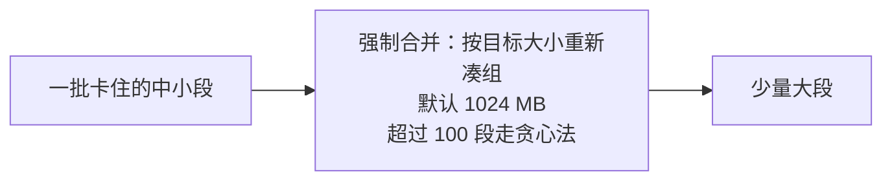

它在后台异步跑，不阻塞查询，但会占 I/O 和内存，尽量放低峰期。

⚠ 官方标注：公开预览阶段，「请勿在生产环境中使用」。
### 四、一个共用机制：Storage V3 清单

背景：数据库随时要回答一个问题——「我现在有哪些数据、分别放在哪个文件里」。2.x 只有 Milvus 自己能看懂。3.0 把这个写成一份公开的「清单」：这版数据由哪些文件组成、删除记录放在哪、统计信息是多少，全写在一张单子上。它有两个特点：

- **只读不改**：数据一变就整张重写一份新单子，旧的留着，历史版本可回溯；
- **自带说明**：文件在哪、怎么读，单子上都写着，外部工具（比如 Spark）拿着它就能直接读，不用连 Milvus 的目录服务。

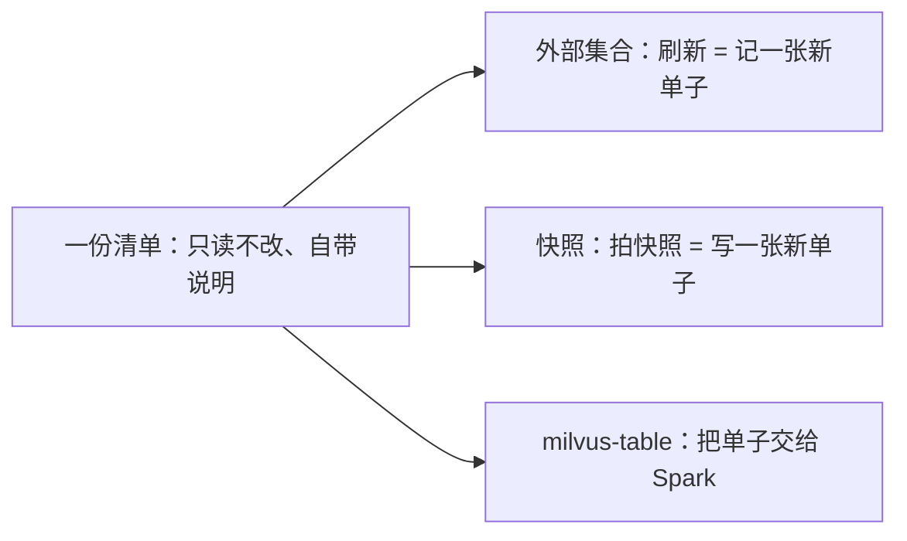

**用法一：外部集合的刷新，本质是记一张新的账单。**

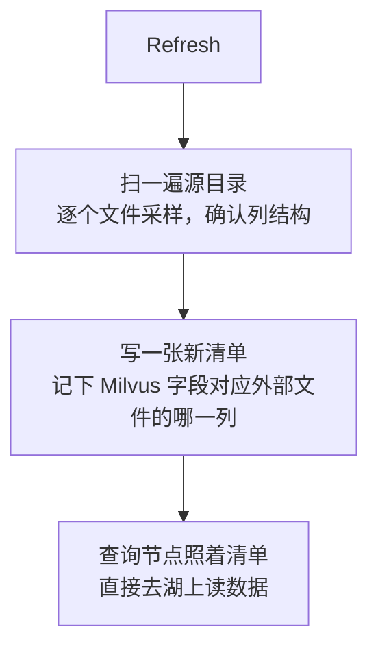

所谓刷新，就是把源目录下的文件重新扫一遍，生成的清单覆盖「此刻这个目录里能看到的全部行」——这就是「全量刷新」的全量。数据一直留在湖上，Milvus 手里只有记账单。目录里多个文件各算各的行，不按主键合并。增量刷新时，没变的文件直接复用原来的数据和索引，只有变了的文件重建；新索引建好之前，查询继续用旧版本。

**用法二：快照为什么便宜。**

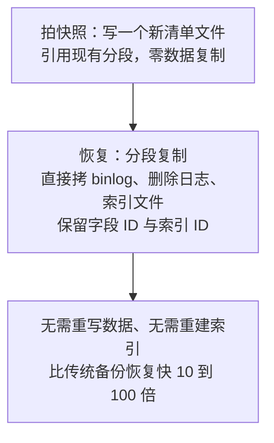

关键点：清单只能引用已经落盘成独立文件的段。还在内存里没落盘的数据没有文件可引用，快照就拍不到它——7.2.8「不 flush 恢复出 0 行」就是这条规则的直接后果。

快照的成本结构：

| 环节 | 实际成本 | 
|---|---|
| 创建 | 写一个清单文件，毫秒量级 | 
| 保存 | 引用会阻止旧文件被垃圾回收 | 
| 恢复 | 复制文件、重建元数据，仍需时间 | 

**用法三：milvus-table，让 Spark 这类工具直接读快照。** 

快照本身就是一张指向湖上文件的记账单，按 `milvus-table` 格式注册成外部 Collection 之后，Spark 之类的批处理工具就能和 Milvus 读同一份数据。 必须走注册这条路：直接把快照文件丢给 Spark 会丢 Schema 和删除记录：
```python
# 1. 拿快照存储位置
snapshot_info = client.describe_snapshot(
    snapshot_name="analytics_snapshot_20260321",
    collection_name="my_collection",
    include_collection_info=True,
)
external_source = f"s3://bucket/{snapshot_info.s3_location}"

# 2. 按 milvus-table 格式建外部 Collection 并刷新
schema = client.create_schema(
    external_source=external_source,
    external_spec='{"format": "milvus-table", "extfs": {...}}',
)
schema.add_field(field_name="id", datatype=DataType.INT64, is_primary=True, external_field="id")
schema.add_field(field_name="embedding", datatype=DataType.FLOAT_VECTOR, dim=768, external_field="embedding")
client.create_collection(collection_name="snapshot_external_collection", schema=schema)
job_id = client.refresh_external_collection(collection_name="snapshot_external_collection")
```

刷新完成后建索引、load，就能对快照视图搜索查询。

### 参考文档

- [存储 V3](https://milvus.io/docs/zh/storage-v3.md) · [快照用例](https://milvus.io/docs/zh/snapshot-use-cases.md) · [创建外部 Collection](https://milvus.io/docs/zh/create-an-external-collection.md)
- [Milvus 3.0 发布总览](https://milvus.io/zh/blog/announcing-milvus-3-lake-native-vector-search-and-a-more-powerful-retrieval-engine.md) · [External Collection](https://milvus.io/zh/blog/milvus-3-0-external-collection.md) · [Milvus Snapshots](https://milvus.io/zh/blog/milvus-snapshots.md)
- [Woodpecker](https://milvus.io/docs/zh/woodpecker.md) · [强制合并压缩](https://milvus.io/docs/zh/force-merge.md) · [Milvus 发布说明](https://milvus.io/docs/zh/release_notes.md)

---

## 第四部分 · StructArray：一行多向量不只是换一种存法

> 一行数据常常不是一个向量能说完的——一个视频切成十个片段，每个片段有自己的画面向量和识别结果。StructArray 就是存这种数据的：一行的某个字段是一个列表，列表里每个元素自带固定结构的子字段。下面几节都围绕它展开：同元素过滤、两种检索粒度、混合检索的分数合并、上线前的检查清单。

### 一、同一偏移：标签和置信度必须来自同一个片段

场景：视频库里每个视频切成若干片段，每个片段存了画面向量、场景标签和识别置信度。需求：「找出有厨房片段、而且**这个厨房片段**置信度大于 0.8 的视频」。

片段在列表里的序号（从 0 数起）叫**偏移**，过滤和检索都靠它对位置：

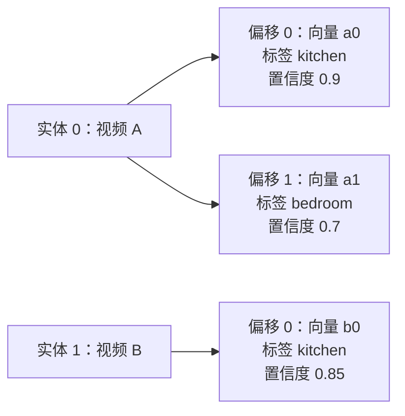

要把上面这个条件查对，数据库必须始终记得：标签是第几个片段的、置信度是第几个片段的——两个序号必须能对上。另外三种存法做不到这一点：

| 存法 | 怎么存 | 为什么不行 |
|---|---|---|
| 拆成多行 | 每个片段单独占一行 | 「视频的权限、标签」这些信息要每行抄一份；查完同一个视频出现好几行，还得合并、去重、重新排序 |
| 多个平行数组 | 标签存一个数组，置信度存另一个数组 | 数据库只看见 `scene_type[3]="kitchen"` 和 `label_confidence[3]=0.9` 两个格子，不知道两个 `[3]` 必须是同一个片段；条件各查各的数组，照样可能跨片段乱配 |
| 普通 JSON | 整个片段列表塞进一个 JSON 字段 | JSON 字段没法给每个片段的向量建索引，也写不出「同一个片段内」的条件——向量检索和精确过滤都做不了 |

所以这类条件要用同元素过滤写：

```text
MATCH_ANY(clips, $[scene_type] == "kitchen" && $[label_confidence] > 0.8)
```

| 表达式 | 父实体通过的条件 |
|---|---|
| `MATCH_ANY` | 至少一个元素满足过滤条件 |
| `MATCH_ALL` | 所有元素都满足过滤条件 |
| `MATCH_LEAST(..., threshold=n)` | 至少 `n` 个元素满足 |
| `MATCH_MOST(..., threshold=n)` | 至多 `n` 个元素满足 |
| `MATCH_EXACT(..., threshold=n)` | 恰好 `n` 个元素满足 |

把同一个需求拆成两个数组条件写，两个命中可能来自不同片段——查询照常返回，但结果已经错了。

### 二、两种检索粒度：问整体还是问片段

接着视频库的例子说。查询时有两种问法，对应两种查法：

**问整体**：「这组画面，哪个视频整体最像？」比如用户传三张截图，各提出一个查询向量。拿这组向量去和每个视频的**整份片段列表**比——每个查询向量都在列表里找一个最像的片段，再把这些分数汇总成这个视频的总分。这种查法要求字段是 EmbeddingList 类型，返回的就是视频本身。

**问片段**：「哪个视频的**第几个片段**最像这张截图？」查询只给一个向量，和每个片段的向量逐个比，返回视频和片段序号。

| 对比 | 问整体（EmbeddingList 实体级） | 问片段（元素级） |
|---|---|---|
| 查询给什么 | 一组查询向量 | 一个查询向量 |
| 和什么比 | 视频的整份片段列表 | 每个片段的向量 |
| 算分方式 | `MAX_SIM_COSINE` 这类 MaxSim 算法 | 普通 `COSINE` / `IP` / `L2` |
| 返回什么 | 视频，一个结果一行 | 视频 + 片段序号（从 0 数起），一个命中片段一行 |

实体级适合什么场景？「一组查询向量对一个实体」：查询一次给多个向量，每个视频也有一整个列表的向量，两边是「一组对一组」。典型场景：一篇文档切成很多块、每块一个向量；一页 PDF 拆成图块去找；一个商品挂多张图一起搜。

它的边界也要知道：实体级只告诉你哪个视频最像，不告诉你是第几个片段像——分数是整个列表汇总出来的，片段信息在汇总时就丢了。想看到具体片段，就换元素级，写法上多两个东西：

- `anns_field` 写 `clips[clip_embedding]`：意思是「拿查询向量和 clips 这个片段列表里的 clip_embedding 向量逐个比」；
- `element_filter`：把标签这类标量条件限定在「正在参与比对的那个片段」上，别的片段不受影响。

结果长什么样也要有预期：元素级默认不按视频分组。一个视频命中了三个片段，结果里就是三行，片段序号各不相同——一行对应一个命中的片段，这是正常现象，不是查错了。

最后一条纪律：两种粒度要分别定义子字段、各自建索引，所以建表时就要想好打算用哪种问法；而且一次检索只能选一种粒度，不能混着来。

### 三、EmbeddingList 候选策略

EmbeddingList 检索比的是「一组查询向量 vs 一整个片段列表」，逐对算一遍太贵，所以执行拆成两阶段——先粗筛，再对筛出来的候选精排：

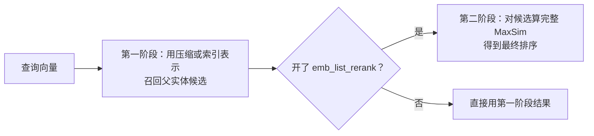

**第一阶段漏掉的实体，第二阶段救不回来**——所以选型先看召回率，再看延迟和索引大小，用自己真实的列表长度分布测。

三种策略（TokenANN / MUVERA / LEMUR）的对比与选型见 [7.4.3](./7.4-Milvus3.0索引与性能选择)。

### 四、Hybrid Search：什么时候保留片段身份，什么时候折回实体

混合检索是一次请求里带多个子检索。多个子检索的结果怎么合，取决于子检索的类型：

| 子请求组合 | 最终候选粒度 | 结果身份 |
|---|---|---|
| 所有子请求都是元素级，并且都指向**同一个 StructArray** 下的向量子字段 | 元素级 | 主键 + StructArray 字段 + 元素偏移 |
| 任意子请求包含顶层向量字段 | 实体级 | 主键 |
| 任意子请求是 EmbeddingList 检索 | 实体级 | 主键 |
| 元素级子请求指向不同 StructArray 字段 | 实体级 | 主键 |

只有第一种组合保留片段身份；其余组合 Milvus 先把片段分数折算成一个实体分数，再按实体排名。折算的直觉：

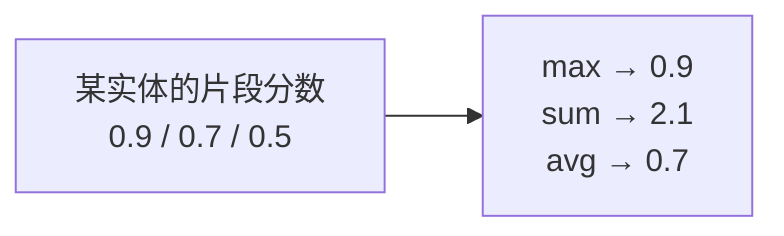

折算函数五种：`max` / `sum` / `avg` / `topk_sum` / `topk_avg`；`sum` 类只能配「越大越好」的度量（`IP`、`COSINE`），别拿 L2 距离去求和。折算只用该子请求已经返回的片段，所以子请求的 `limit` 决定了有多少片段参与折算。

### 五、物理存储：嵌套对象拆成有类型的子列

底层的存法是这样的：一行里的嵌套列表拆成有类型的子列存放。每个片段属于哪个实体，由一张映射表记录。检索命中片段、把过滤条件对齐到片段、把结果拼回实体，都靠这张映射表：

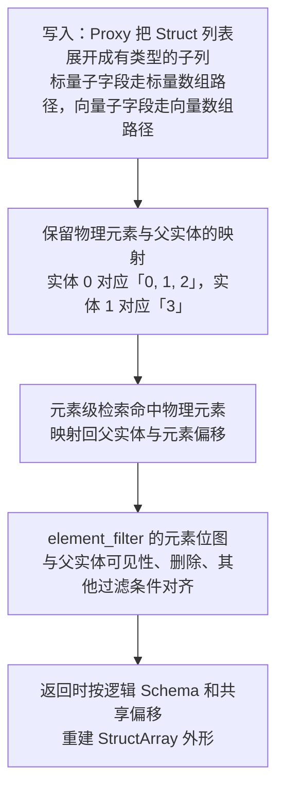

StructArray 的真正价值在于：**嵌套关系本身进入了索引、过滤、候选身份和结果重建**，「能存嵌套 JSON」只是表面。

### 六、上线前的 Schema 检查

- `STRUCT` 只能作为 `ARRAY` 的元素类型，不能作为顶层 Collection 字段；
- StructArray 内不能再嵌套 Struct、Array、ArrayOfStruct 或 JSON 子字段；
- 向量子字段必须先建索引；高频过滤的标量子字段也应选择兼容索引；
- 子字段 Schema 创建后固定，先规划元素属性，别把它当可随时改形的文档模型；
- 一个普通实体、一个向量已经够用时，不为「新」引入多向量成本。

### 参考文档

- [StructArray 概览](https://milvus.io/docs/zh/array-of-structs.md) · [EmbeddingList 策略选择](https://milvus.io/docs/zh/choose-an-embeddinglist-search-strategy.md) · [StructArray 的 Hybrid Search](https://milvus.io/docs/zh/hybrid-search-with-structarray.md)
- [Milvus 3.0 StructArray](https://milvus.io/zh/blog/milvus-3-0-structarray.md)

---
## 第五部分 · Regex 过滤

> 日志排查最常见的需求，是从几百万行里找出「长得像某种结构」的行。比如错误码 E 开头跟四位数字、行里还有 timeout。这种按结构匹配的需求 `LIKE` 写不出来，Milvus 3.0 用 Regex 运算符做：`=~` 表示匹配，`!~` 表示不匹配。这一部分讲四件事：常用写法、在查询里怎么写、字段缺失怎么算、什么时候值得建 NGRAM 索引。顺带一句：只匹配固定前缀时，等值或前缀查询更快，Regex 留给结构复杂的模式。

### 一、常用写法对照表

| 想找什么 | 怎么写 | 说明 |
|---|---|---|
| 行里包含 timeout | `timeout` | 直接写文字本身，行里包含就算命中 |
| 整个值刚好是 timeout | `^timeout$` | `^` 锁开头，`$` 锁结尾，一起用表示「整个值必须是它」 |
| 以 ERROR 开头 | `^ERROR` | `^` 表示行首 |
| 以 timeout 结尾 | `timeout$` | `$` 表示行尾 |
| E 后面跟四位数字 | `E[0-9]{4}` | `[0-9]` 是任意一个数字，`{4}` 表示重复 4 次 |
| 任意内容 | `.*` | `.` 是任意一个字符，`*` 表示重复任意次 |
| ERROR 或 WARN 二选一 | `ERROR\|WARN` | 竖线表示「或」 |

拿一个完整的模式拆开看。`E[0-9]{4}:.*timeout` 从左到右是五段：

- `E`：字母 E 本身
- `[0-9]{4}`：连续四个数字
- `:`：冒号本身
- `.*`：任意内容，长度不限
- `timeout`：文字 timeout 本身

合起来就是「E 加四位数字、冒号、后面随便什么、行里出现 timeout」。

### 二、在查询里怎么写

正则离不开反斜杠，而反斜杠在 Python 字符串里也有特殊含义。表达式从 Python 传到 Milvus 再传给正则引擎，半路容易被转义一次，写成双反斜杠。里外两层都用原始字符串 `r'...'`，反斜杠就原样通过：

```python
filter_expr = r'message =~ r"E[0-9]{4}:.*timeout"'
```


pattern 来自用户输入时，不要手工拼字符串，用模板参数传入，转义和注入两个问题一起避免：

```python
res = client.query(
    collection_name="logs",
    filter="message =~ {pattern}",
    filter_params={"pattern": r"E[0-9]{4}:.*timeout"},
    output_fields=["message"],
)
```

能用在哪：`VARCHAR` 字段、JSON 的某个路径、`ARRAY<VARCHAR>` 的元素，也能放进 StructArray 表达式。

### 三、字段缺失的行：正查反查都不出现

日志字段经常缺失。字段值不同时，正反两个查询的判定结果：

| message 的值 | `message =~ "timeout"` | `message !~ "timeout"` |
|---|---|---|
| `"request timeout"` | TRUE | FALSE |
| `"request completed"` | FALSE | TRUE |
| NULL（路径缺失、类型不适用同理） | UNKNOWN | UNKNOWN |

`filter` 只返回 TRUE 的行，所以缺失的第三行在正查反查里都不出现。直觉容易犯错的地方：把缺失当 FALSE 再取反，第三行就混进「不匹配」的结果。Milvus 不是这么做的：它把 `!~` 当成「对 `=~` 取反」执行，缺失值取反后还是 UNKNOWN，两个查询都不返回它。

### 四、什么时候值得建 NGRAM 索引

查询进来后，Milvus 不是对每一行都跑正则，而是一步步缩小范围，最后逐行确认：

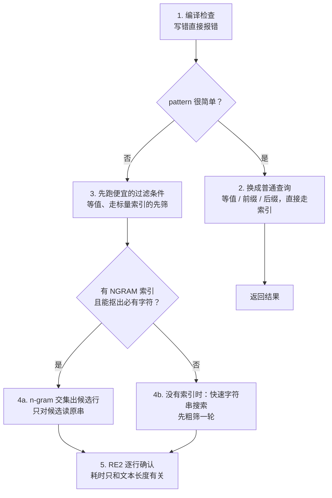

图上的分支补两句：4b 的粗筛只在没有 NGRAM 索引时登场，把「肯定不含这些字符」的行先去掉；粗筛和 NGRAM 都只负责缩小范围，判定由最后一步的 RE2 做。RE2 的特点是耗时只和文本长度成正比，模式写得再怪也不会拖垮服务。

NGRAM 索引的建法就是普通的两步：

```python
index_params = client.prepare_index_params()
index_params.add_index(
    field_name="message",
    index_type="NGRAM",
    params={"min_gram": 4, "max_gram": 4},
)
client.create_index("logs", index_params)
```

建了值不值，官方给过基准：1000 万行、热缓存，测 `ERROR.*timeout`，表里第一列是「真正匹配的行占的比例」：

| 命中行占比 | 原始扫描 p50 | NGRAM p50 | 加速比 |
|---|---:|---:|---:|
| 0.01% | 24.31 ms | 7.47 ms | 3.26× |
| 1% | 26.06 ms | 12.65 ms | 2.06× |
| 10% | 39.86 ms | 30.44 ms | 1.31× |
| 50% | 100.24 ms | 85.73 ms | 1.17× |

结论就一句话：命中行越少，筛掉的越多，越划算。命中行占到一半，只剩 1.17 倍；同一个基准里 `^ERROR` 在 50% 比例下甚至出现 0.69 倍，比原始扫描还慢。这组数字没覆盖还没落盘的新数据、复合过滤、冷启动，上线前用自己的数据实测。

### 参考文档

- [Beyond `=~`：Milvus 3.0 如何把 Regex 变成原生数据库过滤](https://milvus.io/zh/blog/milvus-3-0-regex-filtering.md)
- [Pattern Matching](https://milvus.io/docs/zh/pattern-matching.md) · [NGRAM 索引](https://milvus.io/docs/zh/ngram.md)

---
## 第六部分 · 聚合与 ORDER BY：统计和排序该用哪个

> 检索做完，拿到的只是一个排好序的列表。很多时候要的是进一步的答案：在售商品每个分类有几件、均价多少；这次搜索结果里哪个品牌占大头；结果能不能按价格排序展示。Milvus 3.0 为这些需求准备了四件工具，这一部分讲每件干什么用、什么时候用哪件。

### 一、四件工具怎么选

| 你想要 | 用哪个 | 返回什么 |
|---|---|---|
| 对过滤后的**全部行**做统计 | Query 的分组聚合（`group_by_fields`） | 每组一行：计数、求和、均值 |
| 看**这次搜索候选**里品牌、价格怎么分布 | Search Aggregation | 桶树：每桶计数、均值、代表命中 |
| 搜索结果别被同一篇文档占满，要更多样 | Grouping Search（`group_by`） | 普通 hits，每组留少量实体 |
| 结果按价格、时间等字段排序 | ORDER BY（Query 和 Search 写法不同） | 排序后的行或 hits |

统计和排序看起来可以在应用层自己做，但有一个前提差异要先记住：Query 面对的是过滤后的全部可见行，Search 面对的只是 ANN 筛出来的候选。哪些行可见由 Milvus 决定，客户端拼不出同一个视图；把行取回来自己排，先分页再排序也只能得到页内的顺序。

### 二、Query 的分组聚合：对全部可见行做统计

```python
res = client.query(
    collection_name="products",
    filter='status == "on_sale"',
    group_by_fields=["category"],
    output_fields=["category", "count(*)", "avg(price)"],
)
```

执行方式是逐层汇总，原始行不用全部集中到一个节点：

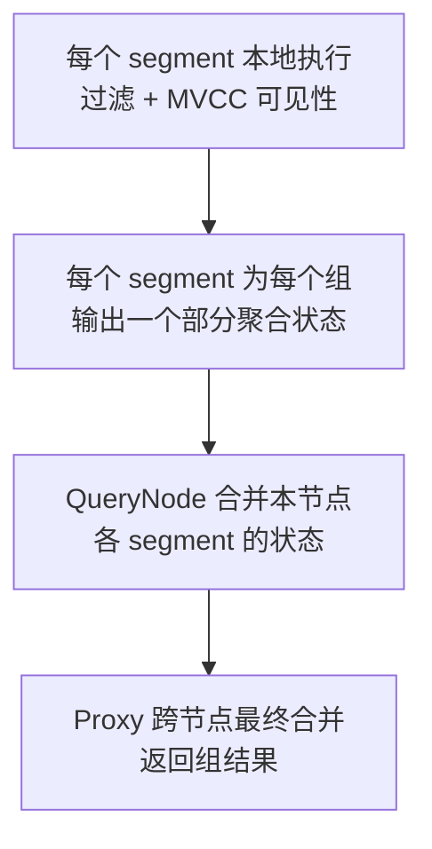

每个 segment 在本地先把每组的计数、和、最值算好，算出的中间结果叫部分状态；再把部分状态往上层交，最后合并成组结果。传输量只跟**组数**有关，跟命中几百万行无关；已删除、已过期的行在本地就算掉了。各聚合函数往上交什么：

| 聚合 | 部分状态 | 合并规则 |
|---|---|---|
| `count` | 局部计数 | 计数相加 |
| `sum` | 局部和 | 和相加 |
| `min` | 局部最小值 | 取最小 |
| `max` | 局部最大值 | 取最大 |
| `avg` | 局部和 + 局部计数 | 分别累加，最后只除一次 |

`avg` 最能说明问题：各分片行数不同，直接把几个局部平均值再平均会算错，所以必须把 `sum` 和 `count` 分别带上来。另外分组 Query 的 `limit` 限制的是**组数**，要全部组就省略它。

### 三、Search Aggregation：统计这次检索的候选

```python
from pymilvus import SearchAggregation, TopHits

aggregation = SearchAggregation(
    fields=["brand"],
    size=10,
    metrics={"avg_price": {"avg": "price"}},
    order=[{"_count": "desc"}],
    top_hits=TopHits(
        size=3,
        sort=[{"_score": "desc"}],  # L2 距离应改为 asc
    ),
)

res = client.search(
    collection_name="products",
    data=[query_vector],
    anns_field="embedding",
    search_aggregation=aggregation,
    output_fields=["title", "brand", "price"],
)

buckets = res.agg_buckets[0]
```

> 构造器签名按 PyMilvus 3.0.2 写成 `fields=[...]` 和 `metrics={"别名": {"操作": "字段"}}`；别的文章出现 `field=...` 简写时以所装版本为准。

开启后普通 hit list 为空，结果读 `res.agg_buckets` 桶树：

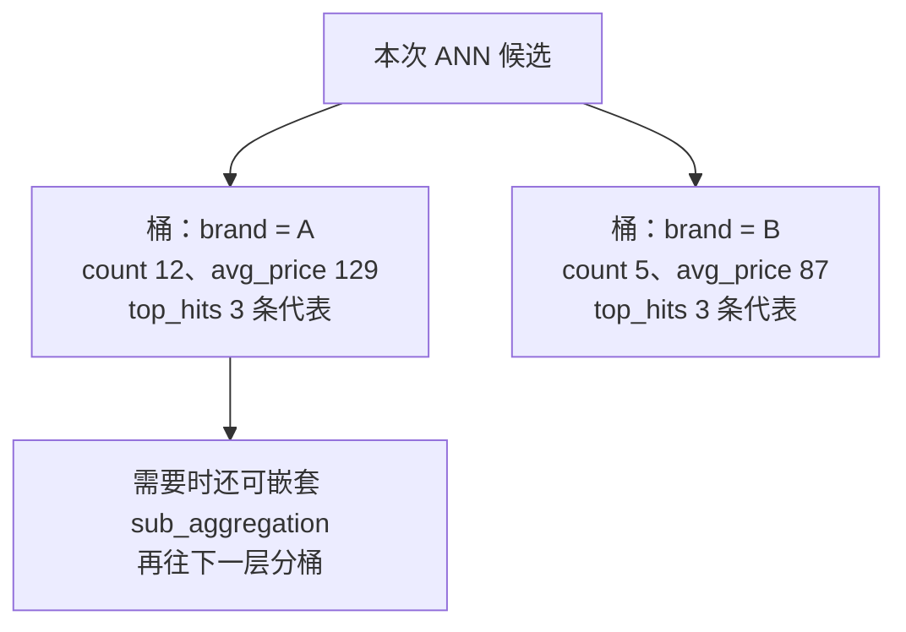

三个要点：

- 两个 size 别搞混：`SearchAggregation.size` 控制最多返回几个**桶**；`TopHits.size` 控制每个桶留几条**代表命中**。桶里的 `count`、`avg_price` 这些指标最多只由这几条代表算出，调大能看得更广，但永远只是候选里的数，变不成全库统计。
- 开启聚合后，顶层 Search 的 `limit` 不起作用。
- 执行顺序是先 ANN 召回，再按桶收拢候选。桶里的 `count` 只是这次候选的统计；要全库的精确数，回到上一节的 Query 分组聚合。

### 四、Grouping 还是 Aggregation

| 应用要做什么 | 用哪个 | 拿到什么 |
|---|---|---|
| 让相关列表按文档、品牌更多样，每组只留一个或少量实体 | Grouping Search | 普通 Search hits |
| 要分面计数、桶内指标、代表命中或嵌套分布 | Search Aggregation | 桶树 |

两种模式返回形态不同，不能在同一请求里组合。RAG 里最容易选错：不想上下文被同一文档占满，用 Grouping；想看候选分布是否集中，用 Aggregation。分布集中与否只是数字现象，不代表答案质量。

### 五、ORDER BY：Query 和 Search 的排序语义不同

Query 用 `order_by`，标量顺序本身定义结果，先过滤、再排序、后分页：

```python
res = client.query(
    collection_name="products",
    filter='category == "books"',
    output_fields=["title", "price"],
    order_by=["price:desc", "title:asc"],
    limit=10,
    offset=10,
)
```

这得到的是「全局按价格排序后的第 11 到 20 行」。Search 用 `order_by_fields`，向量先定候选，标量只重排这些候选：

```python
res = client.search(
    collection_name="products",
    data=[query_vector],
    anns_field="embedding",
    limit=50,
    output_fields=["title", "price"],
    order_by_fields=[{"field": "price", "order": "asc"}],
)
```


### 六、边界与限制

两条边界要记住。第一，Query 的分组聚合是统计，不是完整 SQL：把两张表按条件拼起来查的 Join、窗口函数、复杂子查询都做不了。第二，Search Aggregation 目前不能和这些功能在同一个请求里用：Hybrid Search（多路检索）、Grouping Search（按字段分组）、Search Iterator、非零 `offset`（翻页）、highlighting（命中高亮），需要它们时只能拆成两次请求。

最后一条最容易踩：Search 侧算出来的统计只描述这次检索选中的行，不代表全库。桶里的 `count` 是 12，只说明这次候选里有 12 条是这个品牌，全库里可能有更多。要全库的数，用 Query 的分组聚合。

### 参考文档

- [从检索到结构化结果：Milvus 3.0 的聚合与 ORDER BY](https://milvus.io/zh/blog/from-retrieval-to-structured-results-aggregation-and-order-by-in-milvus-30.md)
- [Query 与标量查询](https://milvus.io/docs/zh/get-and-scalar-query.md) · [Search Aggregation](https://milvus.io/docs/zh/search-aggregation.md) · [单向量检索与排序](https://milvus.io/docs/zh/single-vector-search.md) · [Grouping Search](https://milvus.io/docs/zh/grouping-search.md)

> **返回**：[7.3 数据模型与检索增强](./7.3-Milvus3.0数据模型与检索增强)　·　[7.4 索引与性能选择](./7.4-Milvus3.0索引与性能选择)　·　[7.1 环境升级](./7.1-Milvus3.0环境升级)