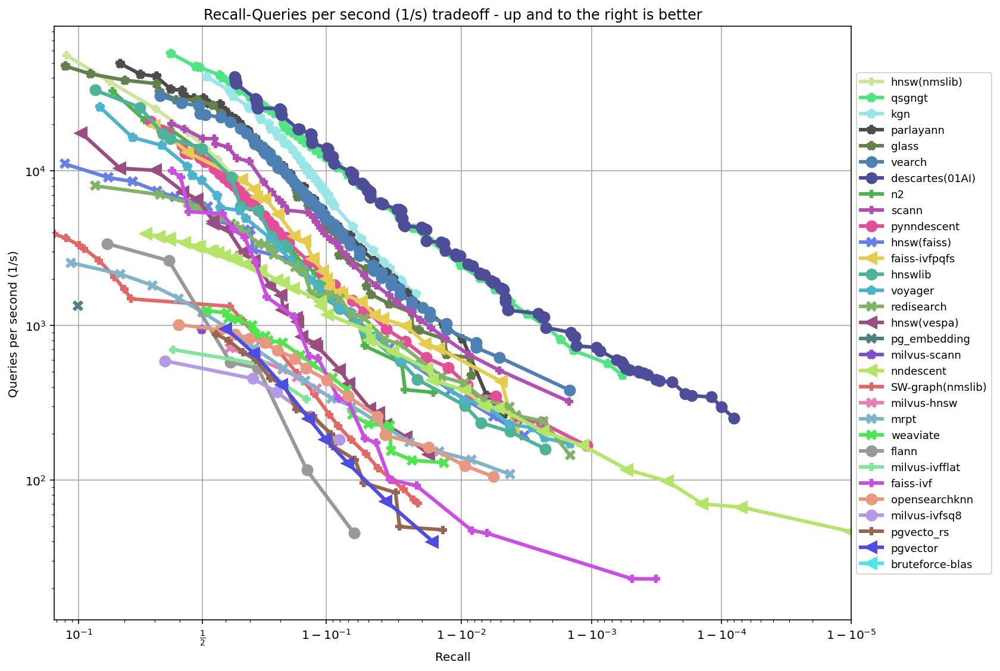

# ANN搜索算法

你已经知道暴力搜索是怎么做的：拿查询向量和库里的每一个向量都算一遍相似度（比如欧氏距离或余弦相似度），排个序，返回最相似的前 K 个。这样做**结果一定准**，因为它把所有的都比过了；但代价也在这里——**库里有几条数据，它就得算几次**。
数据量小的时候无所谓，可当库里从几千条涨到百万、千万条，一次查询就会从毫秒拖到分钟，实时应用根本等不起。维度一高还有个额外的坑：很多向量之间的距离会变得差不多远，最近的那批和只是比较近的那批很难区分开，这种现象通常被叫做“维度灾难”。维度灾难具体怎么影响向量搜索，可以看【向量搜索算法基础】那一章。

**什么是 ANN 搜索？**
ANN（Approximate Nearest Neighbor，近似最近邻）搜索的思路是：不再一个不漏地和全部数据比较，而是先建好索引，把“可能比较像”的一小部分先圈出来，只在这一小部分里仔细比较。这样查询时间和计算量都大幅下降，代价是可能漏掉个别真正很近的邻居，结果不一定百分百全。
所以用 ANN，本质上是在做一笔交易：允许差一点点（召回率略降），换取快很多（延迟低、内存省、建索引成本可控）。本章后面要讲的各类索引，都是从不同的角度做这笔交易。

## 1.索引类型

在向量搜索（Vector Search）中，索引（Index）是加速相似度检索的关键结构。
根据核心思想与数据组织方式，向量索引大体可以分为以下几大类👇

### 1.1空间划分类（Spatial Partitioning）

通过划分向量空间来减少搜索范围。
代表算法：

- IVF（Inverted File Index）：使用 K-Means 将向量聚成多个簇（Cluster），搜索时只在最相近的几个簇内查找。
- K-D Tree / Ball Tree：以树结构递归划分空间，适合低维向量。
- Annoy（Approximate Nearest Neighbors Oh Yeah）：基于多棵随机投影树（Random Projection Tree），在磁盘上高效存储，适合静态数据。

> 📌 特点：粗筛效果好，速度快，但在高维空间性能下降明显。

### 1.2图索引类（Graph-based Index）

通过构建 **向量之间的邻接图（近邻关系）** 来实现高效导航搜索。
代表算法：

- HNSW（Hierarchical Navigable Small World）：分层小世界图结构，搜索从稀疏层向密集层逐步细化。
- NSG（Navigating Spreading-out Graph）：通过优化边连接减少图复杂度，常用于工业大规模检索。
- NN-Descent：通过“近邻传播”构建近似 KNN 图，可作为 NSG 构建的初始图。

> 📌 特点：召回率高、延迟低，是 ANN 检索中的主流索引类型之一。

### 1.3量化压缩类（Quantization-based Index）

通过压缩向量存储与近似距离计算来节省资源。
代表算法：

- PQ（Product Quantization）：将高维向量分块并分别量化，使用短码近似表示原向量。
- OPQ（Optimized PQ）：在PQ基础上增加旋转优化，使量化误差更小。
- SQ（Scalar Quantization）：每个维度独立量化，简单但压缩率有限。  

> 📌 特点：极大降低内存占用，适合海量数据和资源受限场景。

### 1.4哈希类（Hash-based Index）

通过哈希函数将相似向量映射到相同桶（Bucket），实现近似相似度检索。
代表算法：

- LSH（Locality Sensitive Hashing）：通过特定哈希函数（如随机投影）保持相似性。
- SimHash / MinHash：用于文本或稀疏特征的快速相似度匹配。

> 📌 特点：计算简单、可并行，但召回率较低，常用于粗筛阶段。

### 1.5混合索引（Hybrid Index）

结合多种技术取长补短，以兼顾速度、精度与资源。
常见组合：

- IVF+PQ：先聚类再量化，平衡性能与存储。
- HNSW+PQ：在图索引基础上进行量化，适合大规模高维检索。
- ScaNN（Google）：组合可选的空间分区、向量评分和重排。

### 1.6基于磁盘的扩展索引

针对 **超大规模数据（数十亿向量）** 场景：

- DiskANN（Microsoft）：使用图导航、内存压缩表示和 SSD 上的向量及邻接记录。
- SPANN（Microsoft）：使用内存中的质心索引定位 SSD 上的 posting list。

> 📌 特点：通过内存与 SSD 分工，支持内存无法完整容纳的大规模数据集。

## 2.向量索引类型对比表

| 索引类型            | 代表算法              | 核心思想                       | 优势                     | 局限                   |
| ------------------- | --------------------- | ------------------------------ | ------------------------ | ---------------------- |
| **空间划分类**      | IVF, KD-Tree, Annoy   | 空间划分 + 局部搜索            | 简单高效                 | 高维退化               |
| **图索引类**        | HNSW, NSG             | 构建近邻图进行导航搜索         | 高召回率，低延迟         | 构建成本高，更新慢     |
| **量化压缩类**      | PQ, OPQ, SQ           | 向量压缩 + 近似距离计算        | 内存占用低，速度快       | 精度下降               |
| **哈希类**          | LSH, SimHash          | 哈希映射保持相似性             | 查询速度极快，可并行     | 召回率较低             |
| **混合索引**        | IVF+PQ, HNSW+PQ       | 融合多种索引优势               | 平衡速度、精度与存储     | 实现复杂，参数多       |

接下来，本节针对不同索引中的**代表性算法**进行详细介绍。

### 2.1 基于聚类的索引 (IVF)

IVF（**Inverted File Index**，倒排文件索引）是一种**基于聚类思想**的近似最近邻搜索方法。  
它通过将整个向量空间划分为若干个**簇（Cluster）**，并将每个向量分配到对应的簇中，从而在搜索时只需在与查询向量最相近的簇中进行查找，大幅减少搜索范围。

可以把 IVF 想象成在一个**巨大的图书馆**中找书的过程。  
如果所有书籍都杂乱无章地堆在一起，你只能一本一本地翻查，这就相当于**暴力搜索（Brute Force Search）**，效率极低。  
而一个高效的图书馆，会先将书籍按照主题（如文学、历史、科学）分类摆放。这样，当你要找一本“物理学”相关的书时，只需去“科学”书架中查找即可——这正是 IVF 的工作原理。

IVF 采用的核心思想是 **“分而治之（Divide and Conquer）”**：

1. **聚类阶段（索引构建）**：  
   使用聚类算法（如 K-Means）将所有向量划分成若干个簇，并记录每个簇的中心点（Centroid）。  
   每个向量只与其所属簇绑定，形成一种“倒排表”结构。

2. **搜索阶段（查询过程）**：  
   - 首先计算查询向量与所有簇中心的距离；  
   - 选出距离最近的几个簇（通常称为 `nprobe`）；  
   - 仅在这些簇内部进行精细的相似度计算。  

**✅ IVF 的核心优势**

- **高效率**：只在部分簇内搜索，显著减少计算量；  
- **易扩展**：聚类结构清晰，适用于海量向量场景；  
- **可组合性强**：常与 PQ（Product Quantization）或 HNSW 等算法结合，进一步提升性能。  

因此，IVF 是向量数据库（如 **FAISS、Milvus**）中最经典、最广泛使用的索引结构之一，为高维向量的高效检索奠定了基础。

### 2.2 基于图的索引 (HNSW)

HNSW（**Hierarchical Navigable Small World**，分层可导航小世界图）是一种**基于图结构的近似最近邻搜索算法**。  
与 IVF 的“分而治之”思路不同，HNSW 采用的是“以图搜图”的策略——通过构建一个**多层次的邻近关系图（近似小世界网络）**，让向量之间形成高效的导航路径，从而快速找到目标向量。

可以把 HNSW 想象成在一座**多层迷宫城市**中寻找目标位置的过程。  
城市中的每一栋建筑代表一个向量，而道路代表这些向量之间的相似关系：

- 在最上层，只有少量的建筑和粗略的主干道，方便快速确定大致方向；  
- 越往下层，建筑越来越多，道路也越来越密集，用于在局部区域中进行更精确的搜索。  

当有一个查询向量进入系统时，算法会先从最高层开始，像在城市的高空俯瞰一样，快速确定一个靠近目标的大致位置；  
然后逐层向下“着陆”，在更低层的图中进行局部搜索，直到找到最接近的向量。  
**这种“逐层缩小范围 + 层内局部精细搜索”的机制**，使得 HNSW 能在极大程度上兼顾搜索的**速度与精度**。

相比 IVF 依赖聚类划分空间，HNSW 不需要显式的聚类步骤，而是通过构建稀疏的、层级化的图结构，使得每个节点既能快速跳转到远处的区域，又能在邻域内进行细粒度搜索。  
这类似于人类在地图上**先定位城市 → 再找街区 → 最后找到门牌号**的过程。

**✅ HNSW 的核心优势**

- **高查准率**：能在高维空间中保持较高的近似精度；  
- **搜索高效**：图结构天然支持“跳跃式”导航，能快速锁定目标区域；  
- **动态可扩展**：可以逐步插入新向量而无需完全重建索引。  

因此，HNSW 是向量检索中的主流图索引之一，Milvus、FAISS 和 Weaviate 等均提供相关实现。

### 2.3 量化技术 (PQ)

PQ（**Product Quantization**，乘积量化）是一种**向量压缩与近似搜索技术**，其核心目标是——**在保证较高检索精度的同时，显著降低存储空间与计算成本**。  
它通常与 IVF 等索引结构结合使用（如 IVF-PQ），成为高效的近似最近邻搜索方案。

想象一下，你需要在上亿个高维向量中找到最相似的几个向量。  
如果每个向量都要完整地存储和比对，那么不仅占用巨量内存，还会导致搜索时间暴涨。  
PQ 的思路就像是“**把复杂的向量拆开压缩成小片段，再在压缩后的空间中进行高效比较**”。

**🧩 PQ 的核心思想**

PQ 通过一种“分块 + 量化”的策略来表示高维向量：

1. **分块（Subspace Division）**  
   将原始的高维向量（如 128 维）划分为若干个低维子空间（如 8 个 16 维子空间）。  

2. **量化（Quantization）**  
   对每个子空间单独进行聚类（如使用 K-Means），生成多个**子码本（Codebook）**，每个向量在对应子空间中会被表示为**一个聚类中心的编号**。  
   最终，一个向量就不再以浮点数存储，而是以一组“索引编号”表示——大大减少存储空间。

3. **搜索阶段（Approximate Distance Computation）**  
   在搜索时，PQ 不再计算完整的欧氏距离，而是先算好一张“查询向量到每个聚类中心的距离”表，之后每个向量只要查几次表、把各段的距离加起来，就能快速估出相似度。

**✅ PQ 的核心优势**

- **极高的压缩率**：可将原始向量存储空间压缩至原来的 1/10 甚至更少；  
- **计算高效**：通过查表法快速估算距离，极大减少计算量；  
- **可组合性强**：常与 IVF（IVF-PQ）、HNSW（HNSW-PQ）等索引结构结合，兼顾速度与精度。  

**💡 类比理解**

可以把 PQ 想象成“**把一本厚重的百科全书拆分成若干个主题册，然后只保留每册的索引编号**”。  
虽然你丢失了一些细节信息（近似计算），但通过这些编号，你依然能快速定位最相关的章节（相似向量）。

因此，PQ 是现代向量数据库中**兼顾存储效率与搜索速度**的关键技术之一，广泛应用于大规模向量检索场景，如图像检索、文本相似度匹配和推荐系统等。

### 2.4 基于哈希的索引 (Hash-based Index)

基于哈希（**Hashing**）的索引是一类通过**哈希函数将高维向量映射为紧凑的二进制码**的近似最近邻搜索方法。  
它的核心思想是：**相似的向量在哈希空间中应被映射到相似或相同的哈希码上**，从而实现“以码代距”的快速近似搜索。

想象一下，你要在上亿张图片中找到与目标图片相似的几张。  
如果每张图片都需要计算完整的特征距离，代价极高。  
而哈希技术就像为每张图片打上一个“特征指纹”，**相似的图片指纹也会相似**。  
这样，系统只需比较指纹之间的差异（哈希码距离），就能快速筛出候选结果。

**⚙️ 哈希索引的核心思想**

哈希方法的基本流程可分为三步：

1. **哈希函数构建（Hash Function Design）**  
   通过特定的哈希函数（如随机投影、学习哈希）将高维向量映射到低维二进制空间。例如，一个 128 维向量可能被映射成一个 64 位的二进制码。  

2. **哈希码生成（Hash Code Generation）**  
   每个向量被编码成固定长度的哈希码（如 `101010...`），作为数据的“二进制表示”；不同向量可能产生相同哈希码。

   > 为什么不同向量会有相同的哈希码？哈希码只有固定的几十位，能表示的组合是有限的，而向量千变万化，相当于把无数向量塞进有限的“格子”里，总会有几个向量被挤进同一格。

3. **哈希桶查找（Bucket Search）**  
   检索时，系统根据查询向量的哈希码，直接查找与之相同或相近的哈希桶（Bucket）中的向量，而不必遍历所有数据。  
   相似度可通过哈希码之间的 **汉明距离（Hamming Distance）** 进行快速比较。

**✅ 哈希技术的主要优势**

- **比较快**：哈希码就是一串 0 和 1，比相似度时做的是简单的位运算，比老老实实算距离快得多；
- **存得省**：一个向量只存这串 0 和 1，几个字节就够，不用存原来的几百个数字；
- **扛得住大规模**：上亿条数据也能在内存里建得起哈希表。

**⚠️ 哈希索引的局限**

- **精度较低**：哈希映射存在信息损失，可能导致部分近邻被错过；  
- **难以自适应**：传统随机哈希（如 LSH）无法很好适应数据分布。  

因此，在现代向量数据库中，哈希方法往往与其他技术（如 **IVF、PQ、HNSW**）组合使用，用于**粗筛阶段**或**快速预检索**。

**💡 类比理解**

可以把哈希索引想象成**为每个向量生成一张“指纹卡”**。  
当你需要找相似的对象时，不必看完整的照片（向量特征），  
而是只需比对“指纹”是否相似（哈希码距离）。
虽然这种方法略有误差，但在大规模检索场景下，能以极低的成本实现惊人的搜索速度。  

### 2.5 混合索引 (Hybrid Index)

混合索引（**Hybrid Index**）是一种 **融合多种索引技术优势** 的近似最近邻搜索方法。  
它的设计目标是—— **在速度、精度、存储开销三者之间取得平衡** 。
在实际的大规模向量检索系统中，单一索引往往难以同时满足所有需求，因此混合索引成为工业级系统的主流方案之一。

想象一下，你要在一座 **超大型图书馆** 中快速找到某个主题的书：  
- 你可以先根据 **主题分类（IVF）** 确定大致区域；  
- 再用 **哈希指纹（Hashing）** 快速筛掉无关的书；  
- 最后通过 **精确匹配或量化比较（PQ/HNSW）** 确定最相似的几本。  
这套多层过滤与精细查找结合的机制，就是混合索引的核心思想。

**⚙️ 混合索引的常见组合形式**

1. **IVF + PQ（最经典组合）**  
   - 先用 IVF 将向量空间划分为多个簇；  
   - 再在每个簇内部使用 PQ 对向量进行压缩存储与快速距离估计。  
   ✅ 兼顾了搜索速度与内存效率，广泛应用于 FAISS、Milvus 等系统。

2. **HNSW + PQ**  
   - HNSW 提供高精度的图结构导航；  
   - PQ 用于减少存储占用与计算量。  
   ✅ 适合高精度要求但资源受限的场景。

3. **IVF + HNSW**  
   - IVF 用于粗粒度聚类分区；  
   - HNSW 用于分区内的精细图搜索。  
   ✅ 同时提升搜索速度与局部召回率。

4. **Hash + IVF 或 Hash + HNSW**  
   - 先用哈希快速过滤候选；  
   - 再使用更精细的索引算法进行高精度检索。  
   ✅ 适合亿级以上规模的向量预筛阶段。

**✅ 混合索引的核心优势**

- **性能均衡**：融合不同算法优点，在速度、精度、资源占用之间取得最佳折中；  
- **灵活可配置**：可根据场景灵活组合组件（如粗检 + 精检）；  
- **可扩展性强**：支持增量更新与多层次结构优化；  
- **工程实用性高**：已成为向量数据库的主流选择（如 Milvus 的 IVF_PQ、HNSW_PQ、Hybrid Index 等实现）。  

**💡 类比理解**

可以把混合索引理解为一套**多阶段检索系统**：  
像机场安检一样，  
- 第一关快速筛查（哈希/聚类），  
- 第二关重点检测（量化/图搜索），  
- 最后一关人工复核（精确比对）。  

这种多层次策略既能保持高效率，又能确保搜索结果的高质量。

*在单CPU上的[ANN基准测试](https://github.com/erikbern/ann-benchmarks)对比图*

::: tip
本节ANN算法相关代码ipynb：https://github.com/datawhalechina/easy-vecdb/tree/main/src/ANN_alorithms
:::